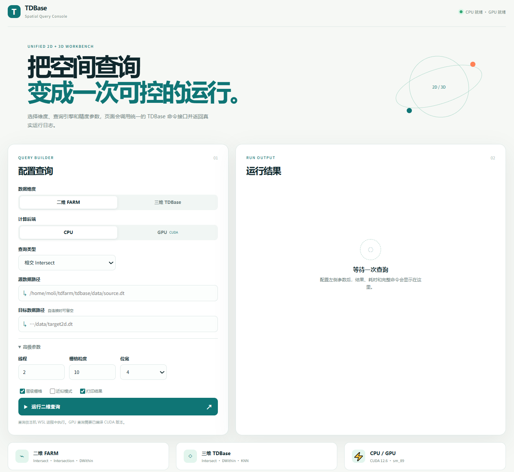

# TDBase：统一二维 / 三维空间查询系统



上图是项目自带的本地网页查询控制台。它把二维 FARM 和三维 TDBase 放在
同一个页面与同一个 `tdbase` 命令入口中，可选择 CPU/GPU、查询类型、距离、
K 值、LOD 以及线程参数，并显示实际执行命令、结果和运行日志。

TDBase 面向复杂三维对象提供多层次渐进压缩、LOD 查询和渐进式精化；FARM
负责二维多边形的栅格化、空间索引、相交、交集面积和距离查询。FARM 已经
放入 `src/farm2d`，由统一的 `tdbase` 可执行文件直接链接，不需要旁边再放置
独立的 FARM 查询程序。

## 功能概览

| 维度 | 统一入口 | 查询 | 主要参数 |
| --- | --- | --- | --- |
| 二维 FARM | `tdbase farm ...` | `intersect`、`intersection`、`within` | 层级栅格、近似模式、距离、位宽、CPU/GPU |
| 二维 FARM | `tdbase join --dim 2 ...` | 同上 | 与三维统一使用 `--tile1/--tile2` |
| 三维 TDBase | `tdbase join --dim 3 ...` | `intersect`、`within`、`nn` | LOD、DWithin 距离、KNN 的 `k`、CPU/GPU |
| 网页界面 | `frontend/server.py` | 上述常用查询 | 参数表单、命令预览、输出、日志、耗时 |

## 目录与文档

```text
src/farm2d/       FARM 二维库、命令行接口、存储、几何和 CUDA 内核
frontend/         本地网页界面（Python 标准库，无第三方运行时）
script/           CUDA 环境和 GPU 构建脚本
tests/            CPU/GPU 冒烟、统一 CLI 和 C++ API 测试
data/             示例原型文件和示例 .dt 数据
```

- [FARM_USAGE.md](FARM_USAGE.md)：二维参数、输出格式、兼容入口和 C++ 接口；
- [FARM_INTEGRATION_REPORT.md](FARM_INTEGRATION_REPORT.md)：统一集成验收记录；
- [frontend/README.md](frontend/README.md)：网页界面启动、查询和接口说明。

## 快速开始

建议在 WSL Ubuntu 中编译和运行。项目需要 CMake、GCC/G++、CGAL、GMP、
Boost.Program_options、ZLIB 和 OpenMP；GPU 构建还需要 WSL CUDA 和 NVIDIA
驱动。Windows 路径 `D:\tdfarm\tdbase` 与 WSL 路径
`/home/moli/tdfarm/tdbase` 可以同步，但 Linux ELF 可执行文件应从 WSL 启动。

纯 CPU 构建：

```bash
cd /home/moli/tdfarm/tdbase
env -u USE_GPU cmake -S src -B build/cpu -G Ninja \
  -DUSE_GPU=OFF -DCMAKE_BUILD_TYPE=Release -DBUILD_TESTING=ON
cmake --build build/cpu --parallel 2
```

GPU 构建：

```bash
cd /home/moli/tdfarm/tdbase
source script/env_cuda.sh
bash script/build_gpu.sh
```

`script/build_gpu.sh` 默认生成 `build/gpu/tdbase`，可用
`CUDA_ARCHITECTURES=89 BUILD_JOBS=4` 调整架构和并行度。两种构建都可以使用
统一的二维 FARM 和三维 TDBase 命令。

## 生成合成数据集

项目提供了合成数据生成工具，可按船只数量、每艘船的对象数量、顶点数量和
采样率生成不同规模的三维数据。帮助信息如下（参数名保持程序原样）：
```console
模拟器参数：
  -h, --help                     显示帮助信息
  --hausdorff                    启用 Hausdorff 距离计算
  -m, --multi_lods               输入来自多个文件的多层多面体
  -i, --allow_intersection       允许细胞与其他细胞或血管相交
  -n, --nuclei arg (=nuclei.pt)  细胞原型文件路径
  -v, --vessel arg (=vessel.pt)  血管原型文件路径
  -o, --output arg (=default)    输出文件前缀
  -t, --threads arg (=8)         线程数
  --nv arg (=50)                 血管数量
  --nu arg (=200)                每条血管的细胞数量
  --vs arg (=100)                每个体素的顶点数量
  --verbose arg (=0)             详细输出级别
  -r, --sample_rate arg (=30)    Hausdorff 距离采样率

```
下面的命令会生成两个 `.dt` 文件，包含 50 个复杂血管和约 10000 个
（50×200）细胞对象。生成后可以直接使用
`foo_n_nv50_nu200_vs100_r30.dt` 和 `foo_v_nv50_nu200_vs100_r30.dt`
进行查询。
```console
./tdbase simulator -n ../../data/nuclei.pt -v ../../data/vessel.pt -o foo --hausdorff --nv 50 --nu 200 -r 30
```
Hausdorff 距离计算当前仅使用 AABB 树，没有启用基于面关联的优化，因此生成
带 Hausdorff 距离的数据会耗时更长。也可以直接使用 `data/` 目录中的预生成
数据。生成的 `.dt` 文件采用压缩格式，查询时会按需解码；转换为解码格式可
提高查询速度，但会增加存储空间占用。

```console
./tdbase convert foo_n_nv50_nu200_vs100_r30.dt decoded_n_nv50_nu200_vs100_r30.dt
./tdbase convert foo_v_nv50_nu200_vs100_r30.dt decoded_v_nv50_nu200_vs100_r30.dt

```

## 运行三维查询

三维支持 KNN（`nn`）、距离查询（`within`）和相交查询（`intersect`）。原有
三维相交路径仍属于实验功能；需要稳定执行距离筛选时，建议使用带明确阈值的
`within` 查询。
```console
TDBase 参数：
  -h, --help                          显示帮助信息
  -t, --threads arg (=8)              线程数
  --cn arg (=1)                       每个 Tile 的几何计算线程数
  -g, --gpu                           使用 GPU 计算
  -v, --verbose arg (=0)              详细输出级别
  -p, --print_result                  将结果打印到标准输出
  --aabb                              使用 AABB 计算距离
  -c, --counter_clock                 面是否按顺时针记录
  --disable_byte_encoding             使用原始 Hausdorff 值而不是字节编码值
  -l, --lods arg                      要处理的 LOD 层级
  --tile1 arg                         Tile 1 路径
  --tile2 arg                         Tile 2 路径
  --max_objects1 arg (=9223372036854775807)
                                      Tile 1 的最大对象数量
  --max_objects2 arg (=9223372036854775807)
                                      Tile 2 的最大对象数量
  -q, --query arg                     查询类型：intersect|nn|within
  -k, --knn arg (=1)                  NN 查询的 K 值
  -w, --within_dist arg (=1000)       within 查询的最大距离
```

下面的命令执行 3NN 连接。加入 `-g` 后使用 GPU 进行几何计算；如果不使用
GPU，可以通过 `--cn 10` 指定 10 个几何计算线程，默认值为 1。
```console
./tdbase join --tile1 decoded_n_nv50_nu200_vs100_r30.dt --tile2 decoded_v_nv50_nu200_vs100_r30.dt -q nn --knn 3 -l 20 -l 40 -l 60 -l 80 -l 100 --cn 10 -p > result.txt

```

### 指定一个三维目标物体

三维命令中的 `--target` 指定 **`tile1` 内的物体编号**，不是 `--tile2` 的
目标三维瓦片。编号从 0 开始，程序会只保留 `tile1` 中该对象后继续执行查询：

```bash
./tdbase join --dim 3 -q nn \
  --tile1 source3d.dt --tile2 target3d.dt \
  --target 3 --knn 1 -l 100 --cn 2 -p
```

上例中 `--target 3` 表示源 Tile 的第 4 个对象，`--tile2` 仍然是另一份
数据集。网页界面中同名的“目标物体 ID”位于“高级参数”内；“目标数据路径”
则对应 `--tile2`。这两个选项含义不同，请分别填写。

`-p` 会把最终结果打印到标准输出；上面的重定向会将结果保存到 `result.txt`。
如果不需要渐进式查询，也可以直接查询最高 LOD：
```console
./tdbase join --tile1 decoded_n_nv50_nu200_vs100_r30.dt --tile2 decoded_v_nv50_nu200_vs100_r30.dt -q nn --knn 3 -l 100 --cn 10 -p > result100.txt

```

将 `-l 100` 改为 `-l 20` 等其他 LOD，可以查询指定层级并获得近似结果。
可以使用下面的 `evaluate` 工具，将近似结果与 LOD 100 的结果进行比较：

```console
./tdbase evaluate result100.txt result.txt

```

下面的命令在单个数据集上执行 3NN 自连接：
```console
./tdbase join --tile1 decoded_n_nv50_nu200_vs100_r30.dt -q nn --knn 3 -l 20 -l 40 -l 60 -l 80 -l 100 --cn 10 -p > result.txt

```

下面的命令执行距离查询，并将距离阈值设置为 100：
```console
./tdbase join --tile1 foo_n_nv50_nu200_vs100_r30.dt --tile2 foo_v_nv50_nu200_vs100_r30.dt -q within -w 100 -l 20 -l 40 -l 60 -l 80 -l 100 -p >result.txt

```

也可以只在最高 LOD 上执行距离查询，然后按照前面的方式评估结果准确性。


## FARM 二维集成

FARM 通过命名空间库 `tdbase_farm2d` 直接链接到 `tdbase` 可执行文件。数据
转换、过滤、二维相交/交集面积/距离查询和原有三维网格查询都可以使用同一个
程序：

```console
bash script/build_gpu.sh
./build/gpu/tdbase farm convert source.wkt source.dt
./build/gpu/tdbase farm convert target.wkt target.dt
./build/gpu/tdbase farm intersect -s source.dt -t target.dt -h -g -p
./build/gpu/tdbase farm intersection -s source.dt -t target.dt -h -g -o areas.tsv
./build/gpu/tdbase farm within -s source.dt -t target.dt -d 2 -h -g -p
./build/gpu/tdbase join --dim 2 -q intersect --tile1 source.dt --tile2 target.dt -g -p
./build/gpu/tdbase join --dim 3 -q within --tile1 source3d.dt --tile2 target3d.dt -w 100 -l 100 -g -p
./build/gpu/tdbase farm --help
```

统一二维命令默认使用 CPU，加入 `-g` 后使用 GPU。`-p` 将结果打印为 TSV，
`-o` 将结果写入文件，`--format json` 选择 JSON 输出。相交和距离查询输出
数据集内对象编号；交集面积查询还会输出输入坐标单位平方下的实际面积，包含
面积为零的候选对。日志和计数写入标准错误。二维中 `-w` 表示位宽，`-d`
表示公里距离；三维参数含义保持不变。二维的 `-h` 表示层级栅格，查看帮助
请使用 `--help`。二维和三维 `.dt` 是不同的数据格式。

原 FARM 查询参数和兼容可执行文件仍然保留。C++ 接口位于
`src/farm2d/api.h`，包含 `Options`、`Result`、`execute`、`convert_wkt` 和
`filter_wkt`。CPU 与 GPU 共用同一套库，FARM 源码、SQL、脚本和许可证均保留
在 `src/farm2d`。完整参数表、输入几何限制、C++ 示例、构建命令和输出语义
见 [FARM_USAGE.md](FARM_USAGE.md)，验证记录见
[FARM_INTEGRATION_REPORT.md](FARM_INTEGRATION_REPORT.md)。

```console
cmake -S src -B build/unified-cpu -G Ninja -DUSE_GPU=OFF -DCMAKE_BUILD_TYPE=Debug -DBUILD_TESTING=ON
cmake --build build/unified-cpu --parallel 2
ctest --test-dir build/unified-cpu --output-on-failure
python3 tests/unified_cli.py build/unified-cpu . build/unified-validation/cpu
ctest --test-dir build/gpu --output-on-failure
python3 tests/unified_cli.py build/gpu . build/unified-validation/gpu --gpu
```

可以设置 `CUDA_HOME`、`CUDA_ARCHITECTURES` 或 `BUILD_JOBS` 调整 GPU 构建脚本。
显式指定 `-DUSE_GPU=ON/OFF` 后，以该选项为准，不受旧环境变量影响。使用
`-DFARM_PROFILE_QUERY=ON` 可开启详细 FARM 查询分析。FARM GPU 查询会预留两个
4 GiB 临时缓冲区，在 16 GiB 显存设备上建议顺序执行大查询。上述三维相交的
实验性限制与二维集成相互独立。

## 网页查询界面

本地浏览器控制台位于 `frontend/`。页面支持选择二维/三维、CPU/GPU、相交、
交集面积、DWithin 距离和三维 KNN 的 `k`，随后调用同一个统一的 `tdbase`
可执行文件。三维高级参数中还可以填写目标物体 ID，该值生成属于 `tile1` 的
`--target`；目标数据路径则生成 `--tile2`。

```console
python3 frontend/server.py --gpu-build build/gpu --cpu-build build/cpu --port 8765
# 在浏览器打开 http://127.0.0.1:8765
```

请在 WSL 中运行服务，以便执行 Linux 可执行文件并访问 WSL 数据路径。只使用
一个构建目录时，可传入 `--build build/gpu` 或 `--build build/cpu`。页面没有
第三方运行时依赖，会显示生成的实际命令、匹配数量、耗时、标准输出和日志。

服务只监听 `127.0.0.1`。`GET /api/health` 用于检查 CPU/GPU 构建是否存在，
`POST /api/query` 用于执行查询。请求中的路径必须能被 WSL 访问，例如
`/home/moli/tdfarm/tdbase/data/source.dt`。完整 API 和请求体说明见
[frontend/README.md](frontend/README.md)。
