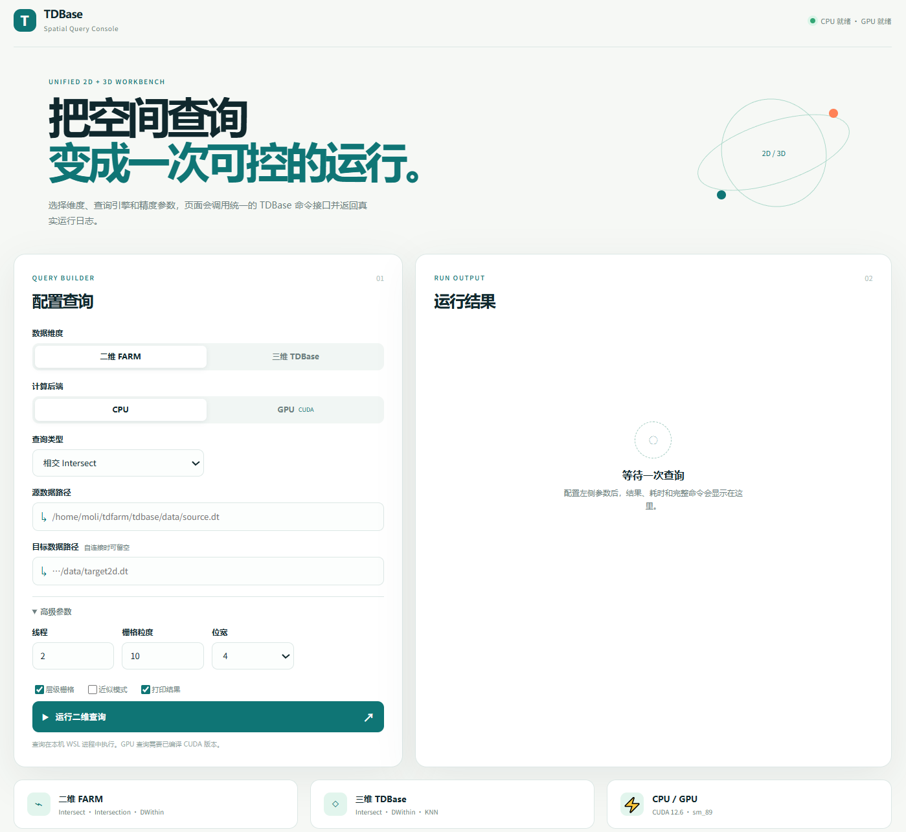

# TDBase / FARM 网页查询界面



这是 TDBase 与 FARM 的统一本地查询页面。页面中的“目标物体 ID”是三维
TDBase 的 `--target`，表示 `tile1` 内的对象编号；“目标数据路径”对应
`--tile2`，表示另一份目标数据集。两者用于不同用途，请按查询场景分别填写。

这是一个零第三方依赖的本地页面。它由 Python 标准库 HTTP 服务提供页面和
接口，并直接调用已编译的统一 `tdbase` 程序。

## 启动服务

推荐同时指定 GPU 和 CPU 两个构建目录，这样页面可以切换计算后端：

```bash
cd /home/moli/tdfarm/tdbase
python3 frontend/server.py \
  --gpu-build build/gpu --cpu-build build/cpu \
  --host 127.0.0.1 --port 8765
```

只使用一个构建目录时：

```bash
python3 frontend/server.py --build build/gpu --port 8765
```

浏览器打开 <http://127.0.0.1:8765>。服务只监听本机地址，不上传数据。必须
在 WSL 中启动，因为页面需要执行 Linux `tdbase` 并访问 WSL 数据路径。

## 页面功能

- 二维 FARM：`Intersect`、`Intersection`、`DWithin`；
- 三维 TDBase：`Intersect`、`DWithin`、KNN；
- CPU/GPU 后端切换；
- DWithin 距离、KNN 的 `k`、LOD、线程和二维栅格参数；
- 三维高级参数中的目标物体 ID（生成 `--target`）；
- 实际命令、标准输出、运行日志、匹配数量和耗时展示。

二维目标数据路径生成 `-t/--tile2`。三维目标数据路径生成 `--tile2`，而
高级参数里的目标物体 ID 生成 `--target N`，并且只作用于 `tile1`。例如：

```bash
tdbase join --dim 3 -q nn --tile1 source.dt --tile2 target.dt \
  --target 3 --knn 1 -l 100 --cn 2 -p
```

路径必须是运行 Python 服务的 WSL 环境可访问的路径，例如
`/home/moli/tdfarm/tdbase/data/foo_n_nv50_nu200_vs100_r30.dt`。GPU 页面要求
GPU 构建目录中存在 `tdbase`，并且 WSL CUDA 环境可用。

## 接口

`POST /api/query` 接收页面表单对应的 JSON，`GET /api/health` 返回 CPU/GPU
构建发现状态。查询超时可用 `--timeout` 调整，默认 600 秒。

三维指定物体时，JSON 中使用 `target_object`：

```json
{
  "dimension": "3d",
  "backend": "cpu",
  "query": "nn",
  "source": "/home/moli/tdfarm/tdbase/data/source.dt",
  "target": "/home/moli/tdfarm/tdbase/data/target.dt",
  "target_object": 3,
  "k": 1,
  "lods": "100",
  "compute_threads": 2
}
```

服务返回实际命令、退出码、耗时、匹配数量、标准输出和标准错误。后端会校验
目标物体 ID 为非负整数，并在生成命令时将它放在 `--target` 后面。
